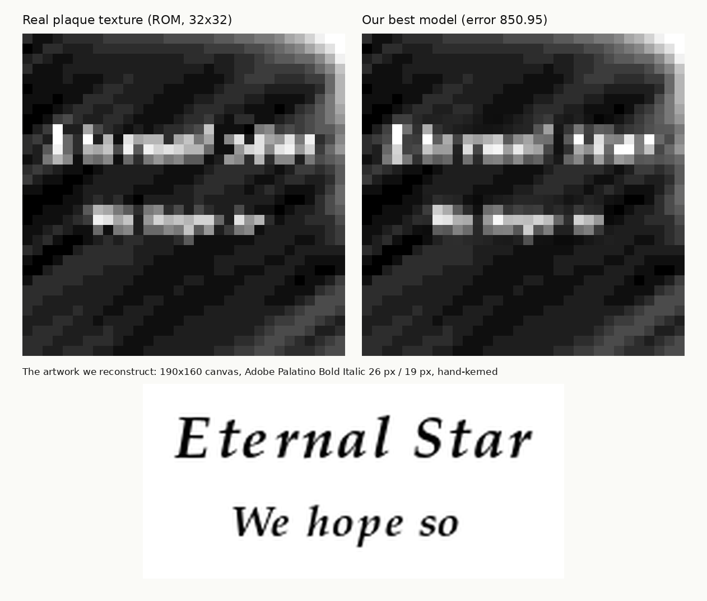

# What does the Super Mario 64 courtyard plaque say?

**Short answer — most likely:**

> ***Eternal Star***
> ***We hope so***

…set in **Palatino Bold Italic**, most likely **Adobe's own 1990 PostScript Palatino** (Adobe Type Manager era), and **not** "L is real 2401".
With that font, a blind search over 17.7k English words returns exactly **"We hope so"** as its best string.

The plaque on the star statue in Peach's castle courtyard is a single 32×32 grey texture. Its two lines of text are
3–5 pixels tall, too small to *read*. This project doesn't try to read or upscale it. Instead it **simulates how a
1996 artist made it** and searches for the text that best explains the stored pixels:
1. Type the text in a period font, on a canvas of some size.
2. Resize to 32×32 with a standard filter.
3. Apply blur and gamma.
4. Lay it on the stone.

Millions of fonts, process settings and texts were scored on a GPU, and the method was calibrated on synthetic
plaques with known text.



📄 **Full report:** [`report/report.pdf`](report/report.pdf) (LaTeX source in `report/`)

## Key results

| question | answer | evidence |
|---|---|---|
| font | **Palatino Bold Italic** — best of all: Adobe's 1990 Type 1 original | best of ~530 era fonts and of every Palatino digitisation 1990–1999 (Adobe, Apple, URW, Linotype); wins an identical rigid process search against Times, New Century Schoolbook, Bookman, Georgia, Helvetica, Zapf Chancery, Courier… |
| in-game font? | **No** | SM64's own dialog font (extracted from the ROM, same process search) fits far worse than Palatino and ranks near the bottom |
| process | 160×128 artwork, 23 px type, tracking +1, whole-pixel advances, **bilinear** resize, blur σ≈0.45 px, **gamma 1.8** | the free URW clone and the genuine Apple 1996 Palatino independently converge on the same recipe |
| line 1 | **Eternal Star** (capital or lower-case s undecided) | "Star" is rank 1 of 27,122 words with every setting frozen; rivals lose even with their own recipe search |
| line 2 | **We hope so** | same process, centred, same ink level; "hope" is rank 1 of 12,556 middle words. Fitting line 2's own typesetting on "hope" alone makes "We" and "so" the best real words on their own (held-out) pixels, and the unconstrained dictionary search then finds "We hope so" among its top 3 |
| inversion | supports it | running the fitted process backwards: the inverted plaque correlates 0.74 / 0.76 (row 1 / row 2) with inverted "Eternal Star / We hope so", vs 0.29 for "L is real 2401" and 0.30 for "A Secret star" |
| "L is real 2401" | rejected | scored as claimed (whole phrase on row 1, no claim about row 2): row 1 fits about twice as badly as "Eternal Star" |

How much to trust it:
- **Strongly supported:** "Eternal", "Star", "hope".
- **Well supported:** "We".
- **Best-fitting, but by a smaller margin:** "so". It is the best real ending, ahead of "or", "us" and "he".

See the report for the calibration and its limits.

## Reproduce it

You need your **own** Super Mario 64 ROM (US, JP, EU, Shindou or iQue — the texture is identical in all of them). No
Nintendo data is included in this repository.

```bash
git clone https://github.com/supermochi64/sm64-plaque-decode && cd sm64-plaque-decode
pip install -r requirements.txt
python -m plaquedecode extract --rom "Super Mario 64 (USA).z64"        # -> texture.npy (stays local, git-ignored)
# fonts: put P052-BoldItalic.otf (free, URW base35) into fonts/  — see fonts/README.md
R=results/recipes_P052-BoldItalic.json
python -m plaquedecode recipe     --font P052-BoldItalic.otf --stage full   # designer-recipe search for line 1
python -m plaquedecode word2      --recipes $R                              # second word of line 1
python -m plaquedecode line2      --recipes $R --mode dp                    # unconstrained dictionary search, line 2
python -m plaquedecode line2      --recipes $R --mode combo --phrases curated
python -m plaquedecode candidates --recipes $R --line2 results/line2_dp_P052-BoldItalic.json
python -m plaquedecode hopefit    --recipes $R --line2 results/line2_dp_P052-BoldItalic.json --fonts2 P052-BoldItalic.otf
python -m plaquedecode simulate   --recipes $R --line2 results/line2_dp_P052-BoldItalic.json
python -m plaquedecode claims     --font P052-BoldItalic.otf --recipes $R
python -m plaquedecode figures    --out report/figures                     # figures + report/tables from results/
cd report && pdflatex main.tex && pdflatex main.tex
```

- A CUDA GPU makes the searches take minutes. The CPU works too, just slowly.
- All result files behind the report are in `results/`, so the figures and tables can be regenerated without a GPU.
- To test a reading of your own:

```bash
echo "Your reading here" > mine.txt
python -m plaquedecode line2 --recipes results/recipes_P052-BoldItalic.json --mode combo --phrases mine.txt --p2 16,17,18
# with line 2's own typesetting calibrated on "hope":
python -m plaquedecode line2 --recipes results/recipes_P052-BoldItalic.json --hopefit results/hopefit_PalatinoBoldItalic.json \
       --mode combo --phrases mine.txt --p2 17,18,19
```

## Repository layout

| path | content |
|---|---|
| `plaquedecode/` | the maintained pipeline: ROM extraction, forward model, recipe search, word/line decoders, simulation, claims, figures |
| `results/` | JSON results used in the report |
| `report/` | LaTeX source, figures, tables, PDF |
| `data/vocab_en_core.txt` | 17.7k-word English vocabulary (SCOWL/Hunspell-derived) |
| `fonts/` | put fonts here (none distributed) |

## Legal

- Super Mario 64 is © Nintendo. This repository contains no ROM data, no texture and no Nintendo assets; the texture is
  extracted from your own copy at run time.
- The report reproduces the 32×32 texture in its figures for the purpose of commentary and analysis.
- Fonts are not distributed.
- The code is MIT-licensed (see `LICENSE`).
