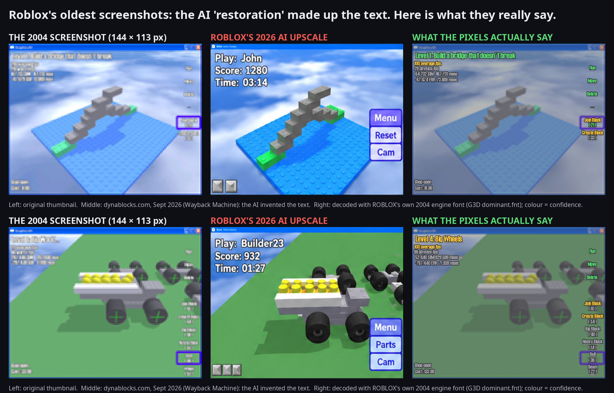
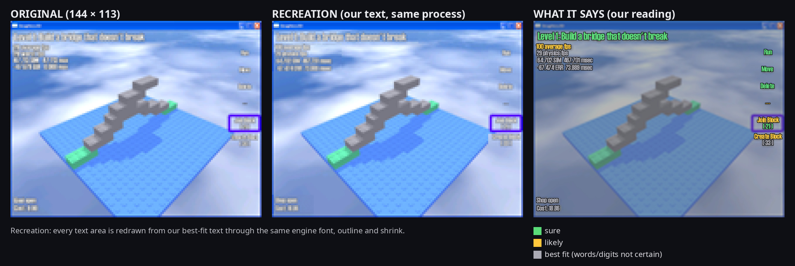
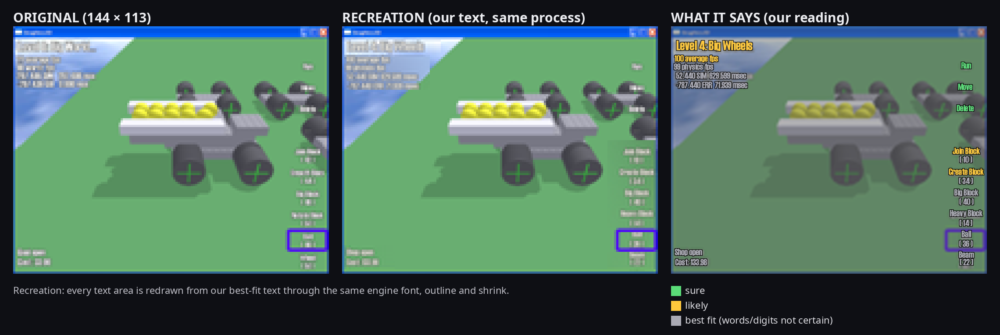

# What Roblox's oldest screenshots really say



In September 2026, Roblox reopened **dynablocks.com** for its 20th anniversary and showed its two oldest game
screenshots in an AI-upscaled version. The upscale looks sharp, but its text was invented: "Play: John / Score: 1280 /
Time: 03:14", "Menu / Reset / Cam". None of that is in the original pixels.

I decoded what the screenshots actually say, using the engine's own 2004 font and the way it drew text.

🏛️ Same method as the main project of this repository: [the Super Mario 64 plaque](../README.md) · and the
[SM64 signpost](../signpost/README.md)

## The short version

- **The screenshots:** two tiny 144 × 113 pixel thumbnails of the January 2004 contest winners of **DynaBlocks**,
  Roblox's original name: "John's Puzzle Game" and "Dump Truck". David Baszucki showed them at BLOXcon 2013.
- **The AI version:** in 2026, dynablocks.com showed them AI-upscaled. The upscaler replaced every piece of text with
  made-up text and a different button layout.
- **What they really say:** screenshot 1 opens with **"Level 1: Build a bridge that doesn't break"**, matching the
  contest description of John's game ("the goal was to build a bridge that cannot break"). The tool bar reads **Run /
  Move / Delete**, followed by building tools like **"Join Block ( 21 )"**.

## What the screenshots say

### Screenshot 1: John's Puzzle Game



| Where | Text | How sure |
|---|---|---|
| title | **Level 1: Build a bridge that doesn't break** | ●●●●● sure (the digit could also be 2 or 7) |
| top left | **100 average fps** | ●●●●○ likely |
| | 29 physics fps | ●●●○○ best fit (the words are likely, the number isn't) |
| | 64.702 SIM  467.701 msec | ●●○○○ best fit (layout only; digits not reliable) |
| | -67.474 ERR  73.889 msec | ●●○○○ best fit (layout only; digits not reliable) |
| buttons | **Run · Move · Delete** · --- | ●●●●● sure |
| tools | **Join Block ( 21 )** (selected) · Create Block ( 33 ) | ●●●●○ likely; "( 21 )" sure |
| bottom left | Shop open · Cost: 18.86 | ●●●○○ best fit ("open" and "Cost:" are likely) |

### Screenshot 2: Dump Truck



| Where | Text | How sure |
|---|---|---|
| title | **Level 4: Big Wheels** | ●●●○○ likely (the number is not readable) |
| top left | 100 average fps · 99 physics fps · two timing lines | as in screenshot 1 |
| buttons | Run · Move · Delete | same as screenshot 1 |
| tools | Join Block ( 10 ) · Create Block ( 34 ) · Big Block ( 40 ) · Heavy Block ( 14 ) · **Ball ( 36 )** (selected) · Beam ( 22 ) | Join/Create likely, rest best fit |
| bottom left | Shop open · Cost: 133.98 | best fit |

In the pictures above, the middle panel is the **recreation**: every text area redrawn from these readings, through the
same font, outline and shrinking as the original. It has the same rhythm, word lengths and darkness as the real
thumbnail. The right panel is the full-size screen with the readings drawn in; green = sure, yellow = likely,
grey = best fit.

## How it works

You can't read 3-pixel letters, but you can rebuild them.

1. **The background.** A community member rebuilt the sky behind screenshot 1 at full size (806 × 632) and found that
   shrinking it with a standard filter matches the thumbnail almost exactly. For screenshot 2, the background is
   estimated from the pixels around each line.
2. **The real font.** Early ROBLOX ran on the open-source **G3D Innovation Engine**. Its text came from a bitmap font
   file, `dominant.fnt` (Haettenschweiler). I used the engine's actual file and its drawing rules: letter widths, line
   height, and the dark outline drawn around every letter. This fits about **twice as well** as an ordinary
   Haettenschweiler TrueType font.
3. **Guess, shrink, compare.** Type a guess, draw it the way the engine did, shrink the screen to 144 × 113 and count
   how far every pixel is from the real thumbnail: the **mismatch score**. Lower is better. For short labels, every
   one of 8,856 English words was tested in each slot.

The title shows how clear it gets for the bigger text:

| Title candidate | Mismatch |
|---|---|
| **Level 1: Build a bridge that doesn't break** | **104** |
| Level 1: Build a tower that doesn't fall | 295 |
| Level 1: Build a bridge that does break | 316 |
| Level 1: Make a bridge that won't break | 319 |

For the buttons, "Move" and "Delete" each came out **first of 8,856** words. The guess people had made before,
"Run / Stop / Reset", doesn't fit: "Stop" ranks 1,299th and "Reset" 1,655th.

## About the AI upscale

The 2026 images are an artistic upscale, not a forgery. An upscaler has to invent detail it can't see, and at this
size the text is mostly invented detail. That's fine for a nostalgic website, but it means the upscaled images can't
be used as a record of what the 2004 screens showed.

This decode works the other way round. Nothing is invented: every reading is a text that, drawn the way the engine drew
it, reproduces the real pixels. No image AI or upscaler was used; an AI coding assistant (Claude) helped write the code.

## What this does not prove

- **This is not a Roblox document.** Only someone who worked on DynaBlocks could confirm it.
- **The small text is the weakest.** The timing lines and most digits are best fits: the word shapes fit, but the
  exact numbers can't be read from 3-pixel digits.
- **Screenshot 2's background is estimated**, so its title and labels are less certain than screenshot 1's.

## Credits

- **The rebuilt sky layer** and the first identification of the font and the G3D engine came from a community member
  in the discussion that started this.
- **Font:** `data/font/dominant-small.fnt` from the G3D Innovation Engine data files (free to use and distribute, see
  `data/font/copyright.txt`).
- **Screenshots:** © Roblox Corporation; the two thumbnails are included for research and commentary. The 2026 AI
  upscales are only shown inside `images/story_*.png`; the originals are on the Wayback Machine (link below).

## Files and how to reproduce

| Path | Content |
|---|---|
| `images/` | the figures on this page |
| `results/readings.json` | every reading with its score, the main alternatives and confidence |
| `results/calib.json` | the fitted text style (calibrated on the title line of screenshot 1) |
| `data/1.png`, `data/2.png` | the two original 144 × 113 thumbnails |
| `data/3.png` | the rebuilt sky layer behind screenshot 1 |
| `data/font/` | the engine font and its licence |
| `code/` | the decoder (Python 3, numpy, Pillow) |

```
cd code
python g3d_bg.py ../data/2.png ../data/bg2.png                     # background estimate for screenshot 2
python g3d_compare.py ../data ../data/font/dominant-small.fnt ../results/calib.json ../data/bg2.png ../images
python g3d_calib.py ../data/1.png ../data/3.png ../data/font calib.json            # re-fit the style from the title
```

`g3d_slot2.py` (whole-vocabulary search for one label), `g3d_lines.py` (candidate lists and word pairs),
`g3d_numfit.py` (number lines, every digit optimised) and `g3d_feas.py` / `g3d_plant.py` (tests with planted text)
produced the rankings in `results/readings.json`.

The AI-upscaled images for `g3d_story.py`:
`https://web.archive.org/web/20260916134715id_/https://www.dynablocks.com/assets/images/1.jpg` (and `2.jpg`).
