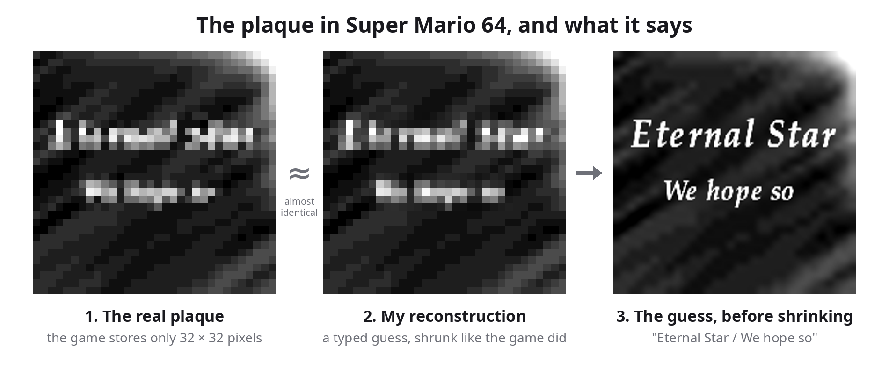
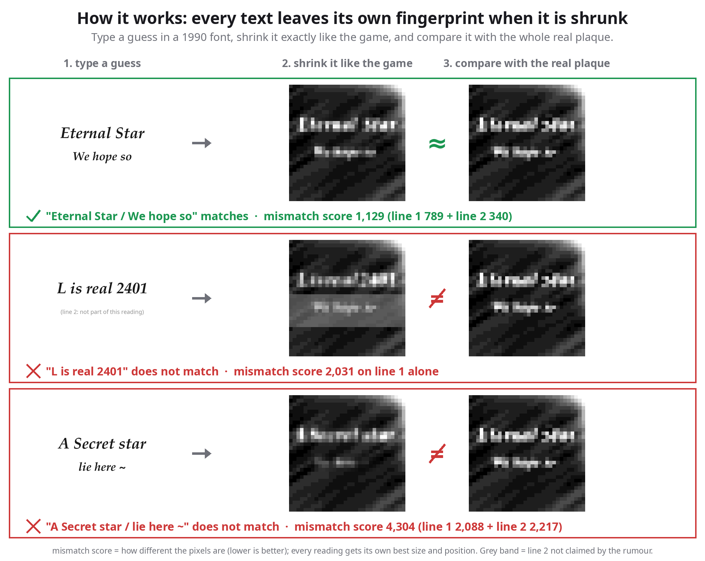
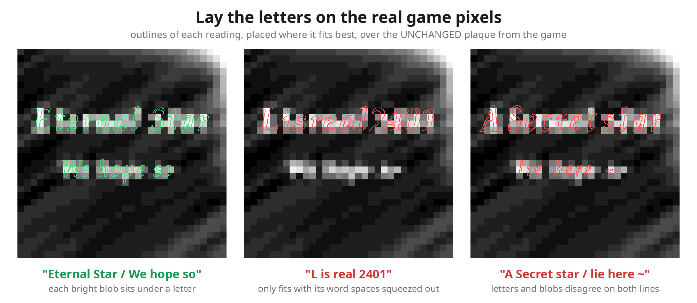
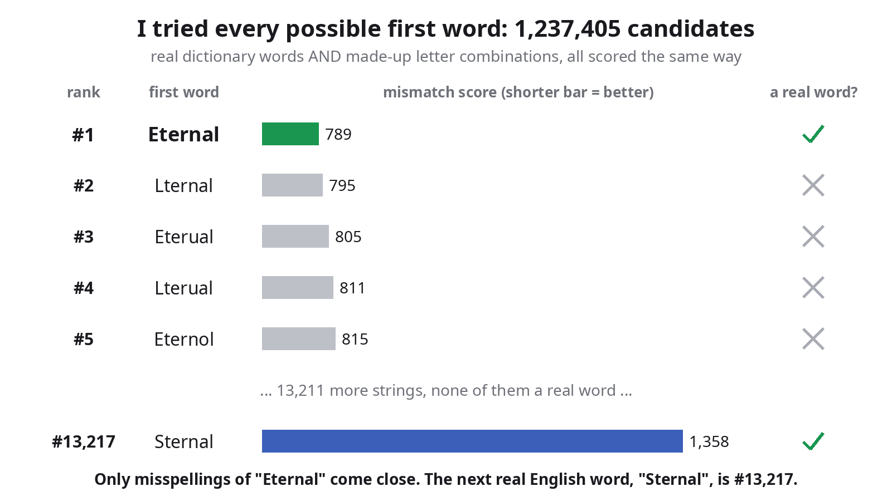
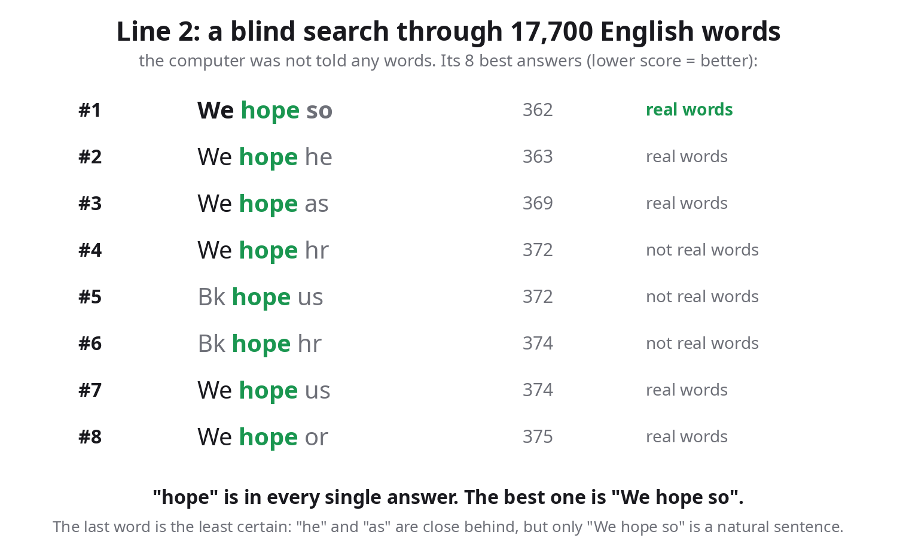
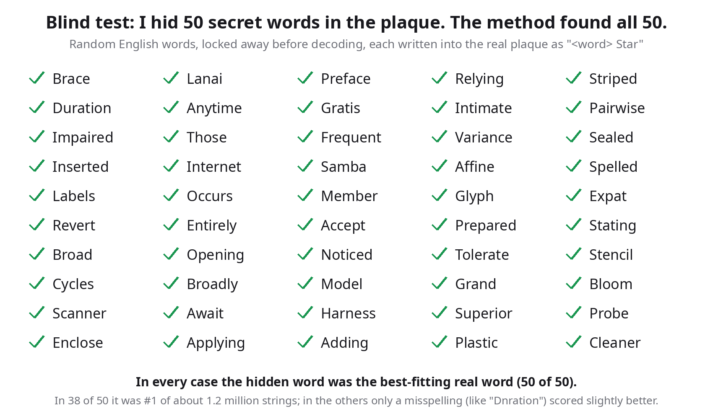
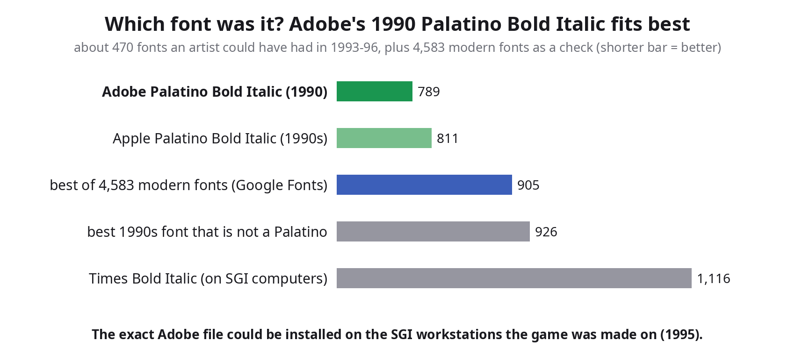
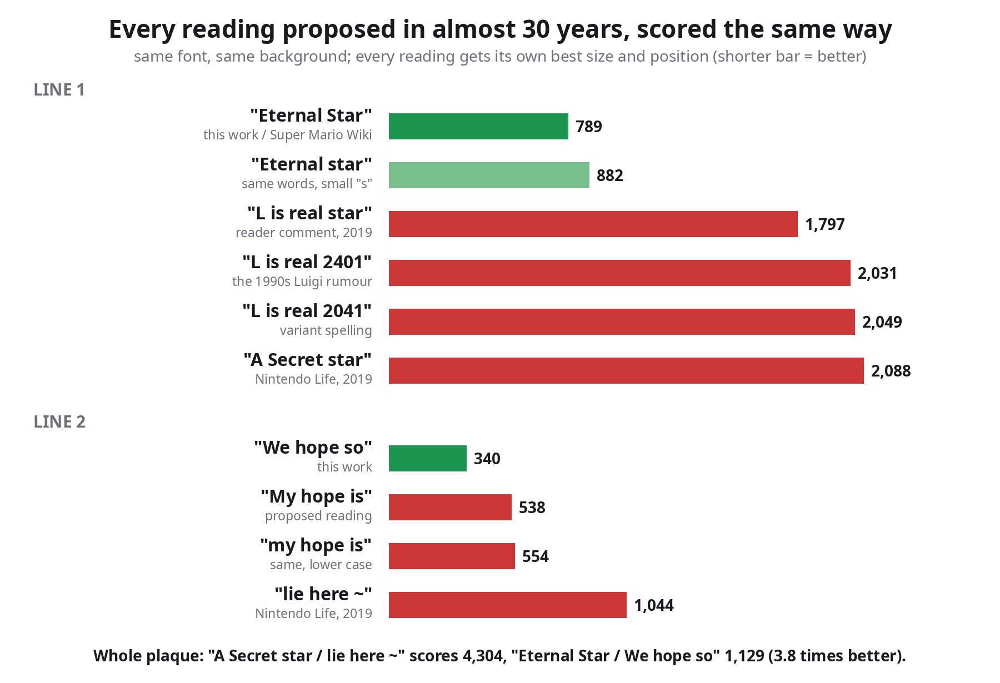
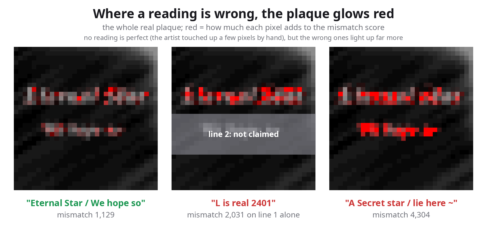

# Super Mario 64's unreadable plaque, decoded: it says "Eternal Star / We hope so"

**For almost 30 years, players have squinted at a blurry little plaque in the castle courtyard of Super Mario 64.
The famous reading, "L is real 2401", launched the legend that Luigi was hidden somewhere in the game. He wasn't. The
plaque says something else: "Eternal Star / We hope so", typed in a font Adobe released in 1990.**

📄 **[Download this summary as a PDF](press_report.pdf)** · 🔬 [Full scientific report (52 pages)](../report/report.pdf)

## The short version

- **Nobody can read the plaque.** The game stores it as one tiny picture, 32 by 32 pixels, and the letters are 3 to 5
  pixels tall.
- **So I stopped trying to read it and rebuilt it instead.** I typed guesses in fonts from the 1990s, shrank them
  exactly the way the game did, and laid them over the real plaque. One text fits: **"Eternal Star / We hope so"**.
- **Then I tried to break my own answer.** 1.2 million rival first words. A blind test with 50 secret words: all 50
  found. About 5,000 fonts. Every reading proposed since the 1990s, scored the same way: "L is real 2401" fits 2.6
  times worse, "A Secret star / lie here ~" almost 4 times worse.

## The mystery

Super Mario 64 came out in 1996. A stone statue holding a star stands in the courtyard of Princess Peach's castle,
and on it sits a small engraved plaque, a smear of grey pixels that no player could ever read. Fans read "L is real
2401" into it, and from that grew one of gaming's most stubborn rumours: that Mario's brother Luigi could be unlocked
somewhere in the game. Kids hunted for him for years. In 1998, Nintendo of America answered a fan's letter and said
the plaque was a joke by the developers with no meaning. What it actually says, Nintendo never revealed.

## How it works

Shrink a word to a few pixels and the letters vanish. Not completely, though. **Every text leaves behind its own pattern
of grey blocks, a fingerprint.** You can't read a fingerprint, but you can take the fingerprints of your own guesses
and check which one matches.

The picture shows it for the whole plaque and three readings. "Eternal Star / We hope so" fits both lines. "L is real
2401" never said what line 2 reads, so I leave line 2 out of its score, and it still fails on line 1. "A Secret star /
lie here ~" fails on both lines.

I did exactly that. Type a guess in a 1990s font, about 26 pixels tall, on a small digital canvas. Shrink it to
32 by 32 pixels the way a 1996 texture artist would have. Lay it on the plaque's stone background. A computer then
counts how far every pixel is from the real plaque and adds it all up into a **mismatch score**: the lower, the
better. I ran this for millions of texts, thousands of fonts and every common way of shrinking a picture.

## Why I am confident

**1. The reconstruction is almost a copy.** The plaque uses 32 shades of grey. Inside the letters, my version is off
by about one shade on average. Look at the first picture again: the real plaque and the rebuilt one are hard to tell
apart. Seven pixels refuse to match in every version I tried, and they look like the artist touched them up by hand.

**2. Every bright blob sits under a letter.**

Draw the outlines of "Eternal Star / We hope so" over the untouched game pixels and each bright smudge lands inside a
letter, down to the dot-like tail of the "p" in "hope". The rivals don't line up. "L is real 2401" only gets close when
the computer squeezes out its word spaces, and "A Secret star / lie here ~" misses on both lines.

**3. "Eternal" beats every other first word I could think of, and 1.2 million I couldn't.**

I didn't hand-pick the rivals. A program assembled 1,237,405 candidates letter by letter: dictionary words, but also
gibberish like "Lternal" and "Eterual". "Eternal" won. The runners-up are all misspellings of "Eternal", and the next
real English word, "Sternal", only shows up at place 13,217.

**4. Line 2 says "We hope so", and "hope" is certain.**

For the second line, the computer combined 17,700 common English words with no hints. "hope" sits in all eight of its
best answers. "We hope so" comes first. Only the last word wobbles: "he" and "as" are close, but they don't make a
sentence.

**5. A blind test: I hid 50 secret words, and the method found all 50.**

Sceptics have one obvious objection. "You found 'Eternal' because you went looking for it." Fair enough. So I let the
computer draw 50 random English words, from "Brace" to "Harness", sealed them away before decoding, and wrote each one
into the real plaque in place of "Eternal". Then the method searched blind. Every hidden word came back as the
best-fitting real word. In 38 cases it even beat all 1.2 million strings; in the other 12, only a misspelling like
"Dnration" (for "Duration") edged ahead.

**6. The font fits, and the artist could have had it.**

I collected about 470 fonts that a texture artist could have owned in 1993 to 1996: from Silicon Graphics computers,
Macs, Windows PCs, Photoshop, Illustrator, CorelDRAW. Adobe's 1990 Palatino Bold Italic fits best, and the twelve best
designs are all versions of Palatino or its close relatives. Palatino itself is a classic, drawn around 1950. I also tested 4,583 modern
fonts from Google's library. None comes close. And the exact Adobe file was within reach: SGI's 1995 operating system
could install fonts from Adobe's "Type On Call" CD, and that CD's Palatino Bold Italic has letter measurements
identical to my file, byte for byte.
Nintendo built Super Mario 64 on SGI workstations.

**7. Every reading proposed in almost 30 years loses.**

I collected every reading I could find: the 1990s rumour "L is real 2401" and its "2041" variant, "L is real star"
from a 2019 reader comment, "A Secret star / lie here ~" from Nintendo Life in 2019, and "My hope is" for line 2. Each
one got its own best letter size and position. None comes close. "L is real 2401" scores 2,031 against 789 for
"Eternal Star", 2.6 times worse, and the whole of "A Secret star / lie here ~" scores 4,304 against 1,129.

The red map shows where. The famous rumour needs a short capital "L", a tiny "is", gaps between the words and four wide
digits. The plaque shows one long, evenly inked first word with no gap after its capital. On line 2, "lie here ~"
predicts letters where the plaque is dark and misses the bright blobs of "hope". The pixels light up wherever the
shapes disagree.

## How sure am I, word by word?

| Word | How sure | Why |
|---|---|---|
| **Eternal** | ●●●●● very sure | #1 of 1.2 million candidates; a blind search finds it on its own |
| **Star** | ●●●●○ sure | #1 of 27,122 words (capital "S" or small "s" can't be told apart) |
| **We** | ●●●●○ sure | the best real word with the right shape |
| **hope** | ●●●●● very sure | #1 of 12,556 words; turns up in every search |
| **so** | ●●●○○ fairly sure | the best real ending, but "or", "us" and "he" are not far behind |

## What does it mean?

A Japanese team made Super Mario 64, and the two lines read like English written by Japanese developers: a name, then
a wish, the way Japanese memorial plaques are often worded. "Eternal Star" is 永遠の星 (eien no hoshi). "We hope so"
is a stock school-English way of saying そうであってほしい, "we hope it is so". Put together: *an eternal star, and we
hope it truly is one.* That's a playful line for a statue that holds a star, and it squares with Nintendo's 1998
answer that the plaque was a joke by the developers. This part is my interpretation. The reading itself comes from
the pixels alone.

## What this does not prove

- **This is not a Nintendo document.** The answer comes from the pixels. Only the original developers can confirm it
  100 %.
- **At this size, some misspelled non-words fit almost as well** as the real words, "Lternal" for example. The pixels
  fix the shape of the letters. Ordinary English decides between a real word and nonsense.
- **"so" is the weakest word.**

Everything is public: the code, every result file and a 52-page report. Anyone can rerun it. And anyone who thinks I'm wrong
can [take the challenge](../CHALLENGE.md): beat my score with a better reading, or hide a secret word and try to fool the
decoder. Every attempt goes on a public leaderboard.

## Questions you might have

**Is this just AI upscaling?** No. No image AI and no upscaler touched the plaque, so nothing was invented. The
program types text, shrinks it and counts pixel differences, like a very patient person with a magnifier and a ruler.
Same input, same result, every time. I used an AI coding assistant (Claude) to write the program; the program itself
contains no AI.

**What's new compared with earlier attempts?** Earlier readings, including the 2019 one in Nintendo Life, came from
reading the pixels by eye, from TV photos or from upscaled images, and upscalers make up detail. I never tried to read
the pixels. I tested every candidate against them and gave each one a score, the earlier readings included.

**Has Nintendo confirmed it?** No. The only official word is that 1998 letter calling the plaque a developers' joke.
I would welcome a comment from anyone who worked on the game.

**Didn't the 2020 Nintendo leak settle this?** No. The leaked files showed that Luigi existed in early development,
which revived the rumour, but they say nothing about the plaque's text. I used no leaked material at all. Everything
here comes from the plaque in the game as sold.

**Could the plaque be in Japanese?** No. A Japanese team made the game, so I tested Japanese text too: kana and kanji,
in Japanese fonts, scored the same way. It fits far worse than English. Japanese characters are square blocks of even
height, while the plaque shows the uneven rhythm of Latin italic letters: tall capitals and ascenders like the "E",
"t", "l" and "S", with small letters in between.

**Is the plaque the same in every version?** Yes. It is byte-for-byte identical in the Japanese, American and
European releases and in the 1997 "Shindou" rumble edition. Nintendo never changed it.

**Why is it so blurry?** The whole plaque is a single 32 × 32 picture, 1,024 pixels, stretched over a stone slab. The
Nintendo 64 had only 4 KB of memory for the textures it draws at any moment, so small pictures were the rule.

**Where does the stone background come from?** From a 1990s stock-photo CD. The Render96 fan community traced it to
image SC003 of the Japanese "Sozaijiten" collection, a photo of brushed metal. The artist rotated it by about 30
degrees and reworked it heavily; I confirmed the direction of the brush marks.

**Could it still say "L is real 2401"?** Not by these pixels. Even with its own best settings and its word spaces
squeezed out, it fits 2.6 times worse than "Eternal Star". It predicts wide digits where the plaque shows italic
letters, and the plaque has no gap where "L is" needs one.

**How can I check this myself?** Everything is on GitHub: the code, every result file, the 52-page report. You can
even run the blind test with your own secret words.

**Who did this?** The independent retro gaming channel mochi64. No connection to Nintendo.

## Fact sheet

| | |
|---|---|
| Game | Super Mario 64 (Nintendo, 1996), castle courtyard, plaque on the star statue |
| The plaque in the game | one picture of 32 × 32 pixels, letters 3–5 pixels tall |
| Most likely text | **Eternal Star / We hope so** |
| Font | Palatino Bold Italic, most likely Adobe's version from 1990 |
| First-word candidates tested | 1,237,405 (real words and made-up letter strings) |
| Blind test | 50 of 50 secret words found as the best real word |
| Fonts compared | about 470 from the 1990s, plus 4,583 modern fonts |
| Earlier readings | "L is real 2401" 2,031 vs. 789 for "Eternal Star" (2.6 × worse); "A Secret star / lie here ~" 4,304 vs. 1,129 (3.8 ×) |
| Same in all versions? | yes, byte-identical in the Japanese, US, European and Shindou releases |
| Code, data, full report | [github.com/supermochi64/sm64-plaque-decode](https://github.com/supermochi64/sm64-plaque-decode) (free and open) |
| Made by | the retro gaming channel mochi64, with the help of AI coding tools (Claude by Anthropic) |
| Press contact | [whitemochi64@proton.me](mailto:whitemochi64@proton.me) |

## Images

All images in [`images/`](images/) may be used for reporting on this research. Please credit **mochi64**.

| File | Shows |
|---|---|
| [`1_answer.png`](images/1_answer.png) | the real plaque, the reconstruction, and the readable text |
| [`2_how_it_works.png`](images/2_how_it_works.png) | the method on the whole plaque: "Eternal Star / We hope so" matches, "L is real 2401" and "A Secret star / lie here ~" do not |
| [`3_every_first_word.png`](images/3_every_first_word.png) | "Eternal" is #1 of 1,237,405 candidates |
| [`4_blind_test.png`](images/4_blind_test.png) | 50 secret words, all found |
| [`5_which_font.png`](images/5_which_font.png) | Adobe's 1990 Palatino Bold Italic fits best |
| [`6_letters_on_pixels.png`](images/6_letters_on_pixels.png) | the letters of each reading laid over the real game pixels |
| [`7_where_wrong.png`](images/7_where_wrong.png) | where each reading is wrong, the plaque glows red |
| [`8_all_readings.png`](images/8_all_readings.png) | every reading proposed since the 1990s, scored the same way |
| [`9_line2.png`](images/9_line2.png) | line 2: "hope" is in every one of the eight best answers |
| [Animations](../README.md#see-it-move) | the real plaque and the reconstruction sliding over each other |

**Contact:** [whitemochi64@proton.me](mailto:whitemochi64@proton.me) · [@supermochi64](https://x.com/supermochi64) on X
