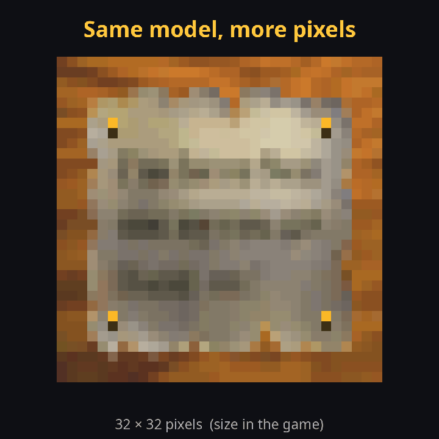
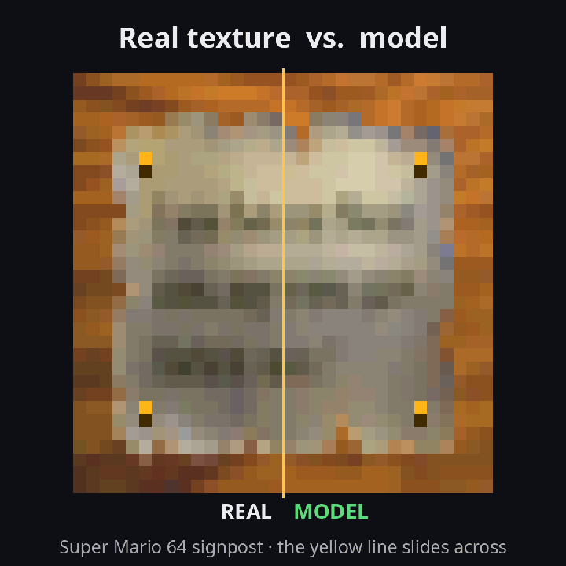
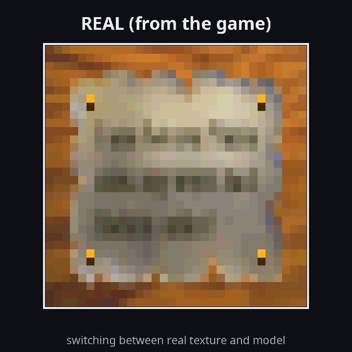
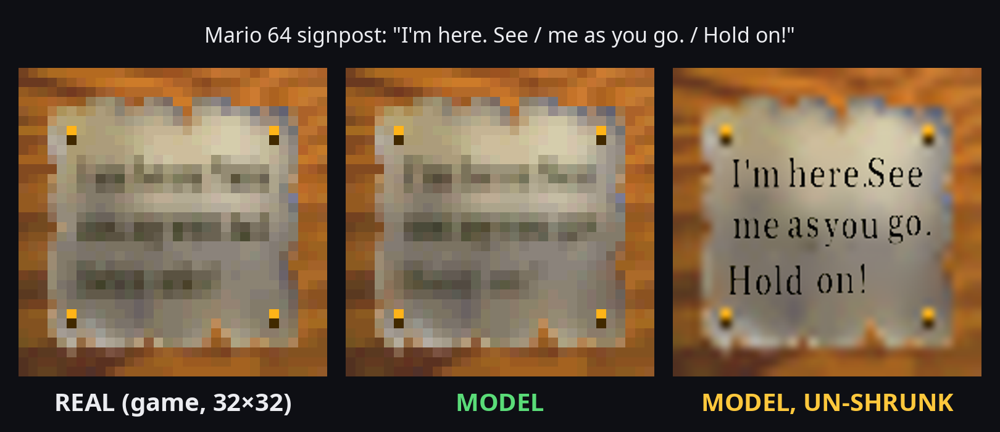

# What does the Super Mario 64 signpost say?

**My best reading:**

> ***I'm here. See***
> ***me as you go.***
> ***Hold on!***

Every wooden signpost in *Super Mario 64* carries the same tiny picture on its front: 32 × 32 pixels, three lines of
writing, each letter about three pixels tall. For almost 30 years nobody could read it, and there wasn't even a theory
about what it might say.

📄 **Full report:** [`report/report.pdf`](report/report.pdf) · 🏛️ Main project: [the courtyard plaque](../README.md)

## See it move

| Real vs. model, side by side | Switching back and forth | From game pixels to readable sign |
|---|---|---|
|  |  |  |
| left of the yellow line: the real game texture, right of it: my rebuild | real texture and model, every 0.4 seconds | the model, from 32 × 32 up to the readable sign |

## How it works, in three steps

1. **Guess a text** and type it in a 1990s font.
2. **Shrink it** exactly the way a texture artist would have back then, and lay it on the painted wooden board.
3. **Compare** with the real 32 × 32 pixels. A computer adds up how far every pixel is from the real sign: the
   **mismatch score**. Lower is better.

The right text gives a rebuilt sign that matches the real one. A wrong text doesn't. I can't read the pixels, but I can
check every guess against them.

No upscaler and no image AI touched the sign; those invent detail. I used an AI coding assistant (Claude) to write the
code. The program itself only types text, shrinks it and counts pixel differences.

## How good is the fit?

The final fit uses all three colour channels of the game texture at once.

| Reading | Mismatch score |
|---|---|
| **"I'm here. See / me as you go. / Hold on!"** | **616** |
| "I'm here. See / us as we are / Find me!" (closest alternative) | 661 |
| "Hi there. Run / to the big tree / Go now!" (a wrong sign of the same shape) | 1,051 |

Inside the text lines, the rebuilt sign is on average **0.7 shades** away from the real one (out of 32), and 82 % of
all values are within one shade.

**How sure am I, line by line?**

| Line | How sure | Why |
|---|---|---|
| **I'm here. See** | ●●●●○ sure | "here." wins every search; "See" beats "Tell" clearly |
| **me as you go.** | ●●●○○ likely | the pixels fix the shape (four short words); "us as we are" is close behind |
| **Hold on!** | ●●●○○ likely | the best two-word closing that fits the width; "Find me!" is close |

This is less certain than the courtyard plaque. The letters are smaller, and the painted paper behind them is unknown,
so the last words are a best fit, not a proof.

## Why it makes sense in Japanese

*Super Mario 64* was made in Japan, and the sign reads like a friendly Japanese sign translated word for word:

| Japanese | Meaning | On the sign |
|---|---|---|
| ここにいるよ | "I'm here!" | I'm here. |
| 通りがかりに見ていってね | "take a look as you pass by" | See me as you go. |
| がんばってね (*ganbatte ne*) | "hang in there / do your best / keep going" | Hold on! |

*Ganbatte* is what you say to someone who is about to do something hard. Japanese school English often turns it into
"Hold on!" or "Hang in there!". A sign that tells Mario to hang in there fits a game where you're about to jump into
danger. It's the same voice as the courtyard plaque's "We hope so" (そうであってほしい).

## What this does not prove

- **This is not a Nintendo document.** Only the original developers could confirm it.
- **The exact font is unknown.** The best fits are all soft upright serif faces of the 1990s (Century 751 fits best);
  the best dozen are within noise of each other.
- **The last words are the weakest.** A different sentence with the same shape could still turn out to be right.

## Files

| Path | Content |
|---|---|
| [`report/report.pdf`](report/report.pdf) | the full report (the first, brightness-only analysis) |
| [`results/colour_refit.json`](results/colour_refit.json) | the final colour fit: score, word positions, ink per line, the two control readings |
| [`results/final_fit.json`](results/final_fit.json) | the earlier brightness-only fit used in the report |
| [`media/`](media/) | the three GIFs above |
| [`images/`](images/) | still images: real vs. model, and real vs. model vs. readable |

The report describes the first analysis on brightness only. There, "…us as we are / Find me!" fit the pixels slightly
better. The newer fit on all three colour channels reverses that, and it is the one summarised on this page.

The signpost uses the same method as the main project of this repository, the courtyard plaque
("L is real 2401" → "Eternal Star / We hope so"). No Nintendo data or commercial fonts are distributed. Images may be
used with the credit **mochi64**.
