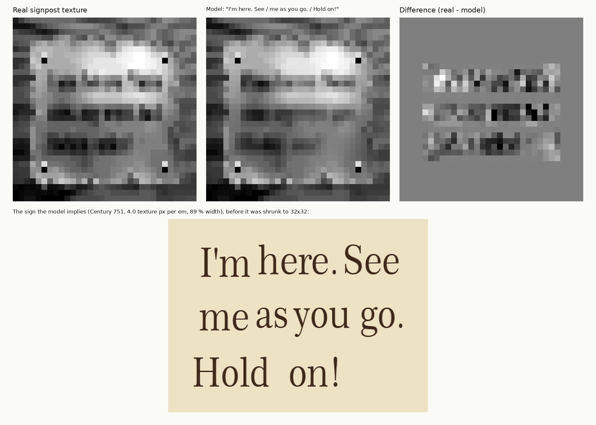

# What does the Super Mario 64 signpost say?

**Our reading:**

> ***I'm here. See***
> ***me as you go.***
> ***Hold on!***

In Japanese, the language it was written from: ここにいるよ。通りがかりに見ていってね。がんばってね！ ("I'm here. Have a look at me as you pass by. Good luck!")

Every wooden signpost in *Super Mario 64* carries the same tiny picture on its front: a 32×32 texture with three lines
of writing, each letter about three pixels tall. Nobody can read it. We didn't try to read it. We rebuilt how such a
picture is made (type a text in a 1990s font, shrink it, lay it on the painted board) and searched for the text whose
rebuilt picture matches the real pixels.

*Left: the real texture. Middle: our model with "I'm here. See / me as you go. / Hold on!". Right: the difference inside
the text lines. Bottom: the sign the model implies before it was shrunk, in the best-fitting font (Century 751).*

📄 **Full report:** [`report/report.pdf`](report/report.pdf) — written to be read from start to finish, no background needed.

## What we found

| question | answer | how we know |
|---|---|---|
| layout | 3 lines: 3 words, 4 short words, 2 words | gaps between the word blocks in the pixels; widths 5/7/6, 5/3/5/4 and 8/6 pixels |
| can it be decoded at all? | only partly | on fake signs made the same way, exact lines come back in at most 13 % of cases, because the painted board behind the letters is unknown. The pixels rule out a lot, but close candidates need more than pixels |
| first line | **"I'm here. See"** | "I'm" was our starting assumption, and a blind test puts it 8th of 4,595 spellings that fit. "here." wins every search. With the right font, "See" beats "Tell" by a wide margin |
| font | an upright **soft serif** (Century / Bookman / Cheltenham type), ~24 px on a canvas six times larger, letters 11–16 % narrower, shrunk by pixel averaging | 2,897 fonts of the period fitted to "I'm here". The exact font can't be named: the best dozens are within noise. Sans-serif fits clearly worse |
| lines 2 and 3 | **"me as you go." / "Hold on!"** | 3.2 billion grammatical signs scored on a GPU. The pixels fix the shape (short words, a 4-pixel last word, a two-word closing), and the sentence that makes sense picks the words |
| does it make sense in Japanese? | yes, very | ここにいるよ (I'm here) + 通りがかりに見ていってね (see me as you go) + がんばってね (hold on / good luck) is the classic friendly voice of a Japanese sign, translated word for word, like the courtyard plaque's "We hope so" (そう願っています) |

**How sure are we?**
- **High:** "I'm here. See".
- **Moderate:** "me", "as" and "Hold on!".
- **Low:** "you", "go.".

By pixels alone, the best-fitting sensible sign is "I'm here. See / us as we are / Find me!". The pixels prefer a
two-letter word where we read "you". We chose the reading that makes sense as a whole sentence and as a translation of
what a Japanese signpost would say. The report shows both kinds of evidence side by side.

## Files

| path | content |
|---|---|
| [`report/report.pdf`](report/report.pdf) | the full report |
| `report/main.tex`, `report/figures/` | LaTeX source and figures |
| `results/final_fit.json` | the fitted font settings, word positions and ink levels of the final reading |

The signpost uses the same method as the main project of this repository, the courtyard plaque
("L is real 2401" → "Eternal Star / We hope so"): see the [main README](../README.md). No Nintendo data or commercial
fonts are distributed.
